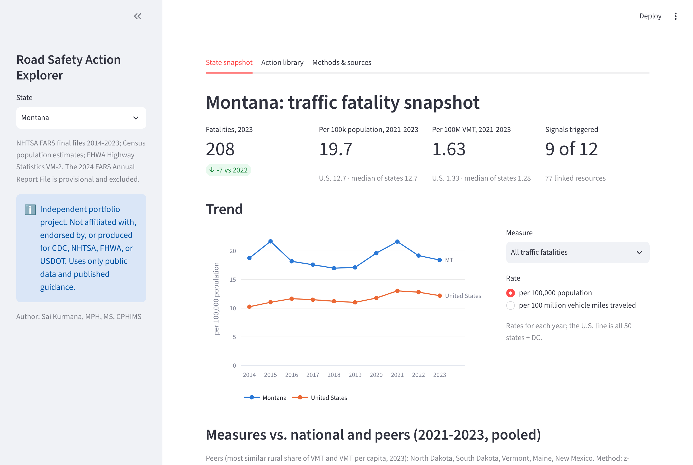
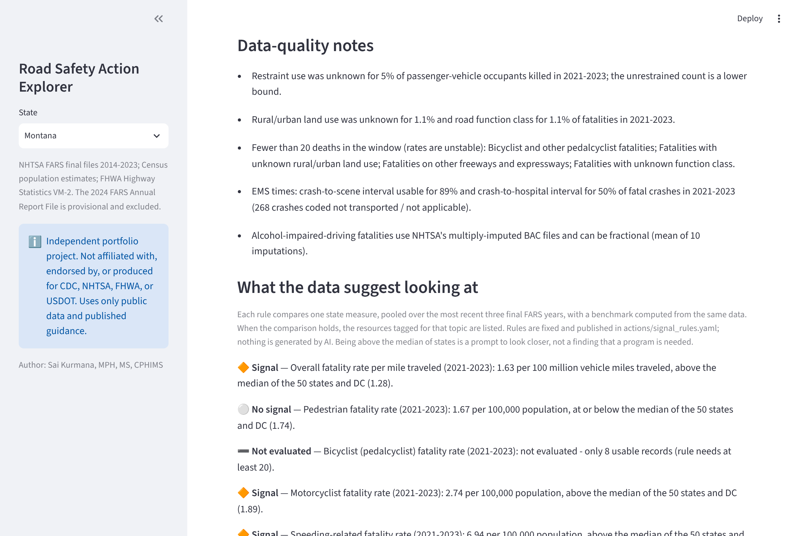
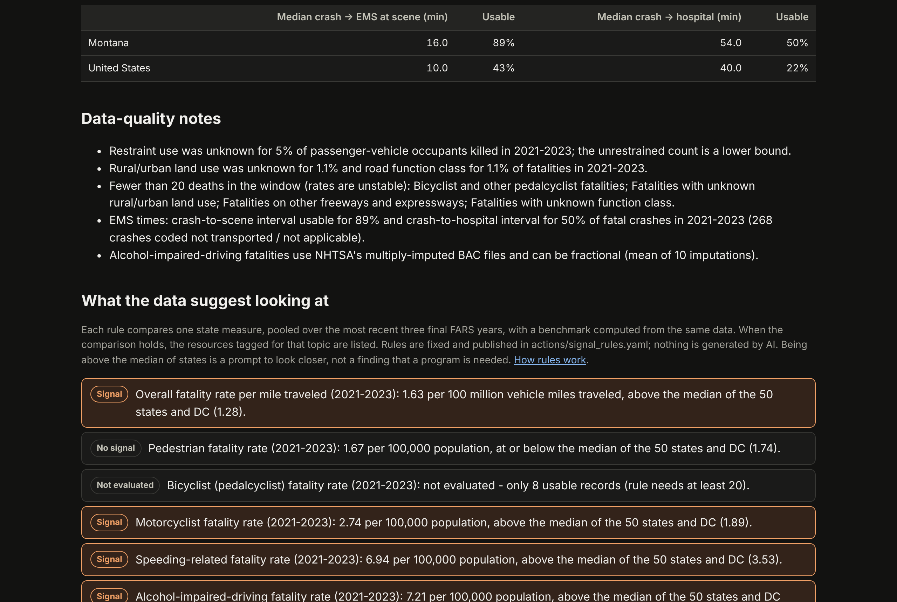
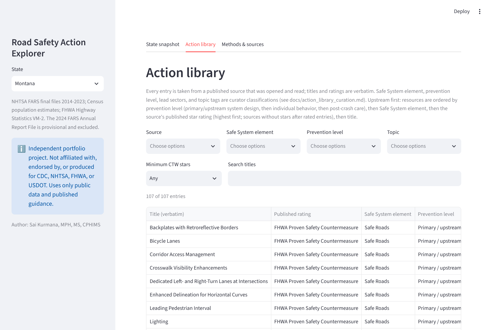
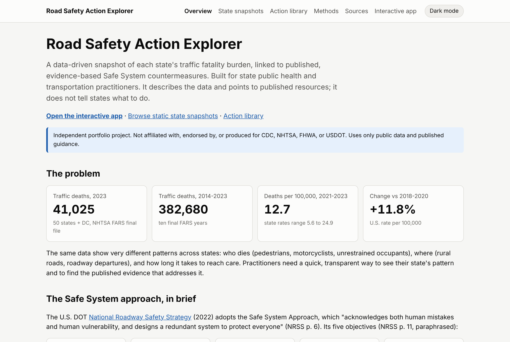

# Road Safety Action Explorer

> **Independent portfolio project. Not affiliated with, endorsed by, or produced for CDC, NHTSA, FHWA, or USDOT. Uses only public data and published guidance.**

A fast, data-driven snapshot of each state's traffic fatality burden, linked to published, evidence-based
**Safe System** countermeasures. Upstream, system-level resources come first (safe roads, safe speeds, safe
vehicles), followed by road-user and post-crash-care strategies. Built for state public health and
transportation practitioners.

- **Interactive app:** `APP_URL` (Streamlit; runs offline from committed data)
- **Static site:** GitHub Pages: landing page, one snapshot page per state, methods, sources, action library



## The problem

In 2023, 41,025 people died in traffic crashes in the 50 states and DC (NHTSA FARS final file). Rates vary
more than four-fold across states: 5.6 to 24.9 deaths per 100,000 population in 2021-2023. The patterns
behind those rates differ just as much:

- **who** dies: pedestrians, motorcyclists, unrestrained occupants;
- **where**: rural roads, roadway departures;
- **how long** it takes to reach care.

Published evidence is spread across several federal guides. This project gives a transparent, reproducible
view of a state's pattern and points to the published resources that address it. It does not tell states
what to do.

## What it demonstrates

- **Verified public-data engineering.**
  - Every source is discovered from the publisher's own listing, checksum-verified, and pinned in
    [`sources.yml`](sources.yml).
  - The FARS CrashAPI returned HTTP 403 from cloud environments, so the pipeline uses NHTSA's official bulk
    files ([why](docs/methods.md#1-data-sources-and-why-bulk-files-are-used)).
- **Analytics engineering with DuckDB + dbt.**
  - Record-level FARS data (2014-2023 final files) are aggregated to state × year.
  - 110+ dbt tests, including state-to-national reconciliation and reproduction of NHTSA's published 2023
    totals (41,025 fatalities; 12,382 alcohol-impaired-driving fatalities).
  - Byte-identical rebuilds.
- **Epidemiologic care.**
  - Rates per population and per VMT, with 3-year pooling and small-count flags.
  - Peer states and data-quality notes.
  - NHTSA's multiple-imputation definition for alcohol-impaired driving.
  - EMS times reported with their completeness.
- **Evidence curation without invention.**
  - 107 resources from NHTSA *Countermeasures That Work* (11th ed.), FHWA Proven Safety Countermeasures, and
    the National Roadway Safety Strategy.
  - Ratings are carried over verbatim; every entry links to the cited PDF page and is machine-checked.
- **Transparent decision support.**
  - Rule-based "signal → resources" logic in plain YAML, displayed in the app.
  - No AI-generated advice.

## Screenshots

These were captured from the running app and site during testing (Montana is shown).

| App: signals and data-quality notes | Site: state page (dark mode) |
|---|---|
|  |  |
| **App: action library with filters** | **Site: landing page** |
|  |  |

## Architecture

```
 Public sources                     Pipeline (Python 3.11)                    Outputs
 ─────────────                     ──────────────────────                    ───────
 NHTSA FARS final bulk files  ─┐   pipeline/sources.py   discover + verify   app/streamlit_app.py  (Streamlit + Plotly)
 (static.nhtsa.gov listing)    │   pipeline/ingest.py    stage → Parquet     sitegen/              (static GitHub Pages)
 Census population estimates  ─┼─► dbt + DuckDB          raw → aggregates ─► data/aggregates/*.csv (committed, <1 MB)
 FHWA Highway Statistics VM-2 ─┘   dbt tests             marts, signals      data/marts/*.csv      (committed)
 CTW / PSC / NRSS PDFs (ROSA P) ─► actions/*.yaml ──────► verify_citations.py
```

- **Raw mode** (`make ingest && make transform`) rebuilds the state × year aggregates from record-level
  files.
- **Committed mode** (CI, `make test`) rebuilds every mart and runs every test from the committed
  aggregates alone. Raw files are never committed.

## Quickstart

```bash
pip install -r requirements.txt
```

```bash
make test
```

```bash
make app
```

These run offline from the committed data. `make site` builds the static site into `site/_build/`. To
rebuild everything from the public sources (about 340 MB of downloads), run `make ingest`, then
`make transform`.

## Sources

All sources were fetched, verified, and recorded with URL, years, file/table ID, checksum, and access date
in [`sources.yml`](sources.yml).

| Source | Years | Identifier |
|---|---|---|
| NHTSA Fatality Analysis Reporting System (FARS), National CSV + Auxiliary CSV, **final** files | 2014-2023 | `FARS{year}NationalCSV.zip`, `FARS{year}NationalAuxiliaryCSV.zip` from the [NHTSA file listing](https://static.nhtsa.gov/?prefix=nhtsa/downloads/FARS/&delimiter=/) |
| U.S. Census Bureau, intercensal state population estimates | 2014-2019 | SC-EST2020INT-ALLDATA6 |
| U.S. Census Bureau, Vintage 2025 state population estimates | 2020-2023 | NST-EST2025-ALLDATA |
| FHWA Highway Statistics, Table VM-2 (each year's edition) | 2014-2023 | VM-2 |
| NHTSA, *Countermeasures That Work*, 11th Edition, 2023 | - | DOT HS 813 490 ([ROSA P](https://rosap.ntl.bts.gov/view/dot/72947)) |
| FHWA, *Making Our Roads Safer: One Countermeasure at a Time* (28 Proven Safety Countermeasures) | - | FHWA-SA-21-071 ([ROSA P](https://rosap.ntl.bts.gov/view/dot/88186)) |
| U.S. DOT, *National Roadway Safety Strategy* (2022) | - | [ROSA P](https://rosap.ntl.bts.gov/view/dot/66388) |
| CDC, Motor Vehicle Injury Prevention Interventions (MV PICCS pages) | - | linked as related resources |
| NHTSA, *Traffic Safety Facts 2024 Data: Alcohol-Impaired Driving* (validation only) | - | DOT HS 813 815 |

**Provisional data:** the newest FARS year in NHTSA's listing, 2024, is an Annual Report File, so it is
**excluded**. Analysis uses the ten most recent final years, 2014-2023.

## How signal rules work

[`actions/signal_rules.yaml`](actions/signal_rules.yaml) holds 12 rules. Each rule compares one state
measure, pooled over 2021-2023, with the median of the 50 states and DC. Example:

> *Pedestrian fatality rate per 100,000 above the median of states → show resources tagged `pedestrian`.*

- **Minimum records:** rules need at least 20 deaths (or 30 valid EMS times); otherwise they are shown as
  "not evaluated".
- **Display:** the app shows each rule's value, comparator, and outcome, and the rule file itself.
- **Ordering:** linked resources are grouped by Safe System element and ordered upstream first (prevention
  level, then element, then the source's star rating).
- **Caveat:** about half of all states sit above any median by construction. A signal is a prompt to look
  closer, not a finding of need.

Details: [docs/methods.md](docs/methods.md#4-signal-rules-resources) and
[docs/action_library_curation.md](docs/action_library_curation.md).

## Limitations

- FARS covers **fatalities only**, not injuries.
- Rates are **not adjusted for all exposure differences** (age, trip mix, terrain, weather).
- Associations are **not causal**.
- **Evidence ratings come from the cited sources**; this project does not rate or recommend countermeasures.
- EMS time data are incomplete in many states. Completeness is reported, and signals are not evaluated where
  data are too sparse.

Full list: [docs/limitations.md](docs/limitations.md).

## Repository map

| Path | Contents |
|---|---|
| `pipeline/` | source discovery and verification, ingest, export, citation verifier, data dictionary |
| `dbt/` | models (staging → aggregates → marts), seeds, tests |
| `actions/` | action library and signal rules (YAML) |
| `data/aggregates/`, `data/marts/` | committed aggregated outputs |
| `app/`, `explorer/` | Streamlit app and shared data/text layer |
| `sitegen/` | static site generator (Jinja2, inline SVG charts, light/dark) |
| `docs/` | methods, data dictionary, curation guide, usability test plan, limitations |
| `.github/workflows/` | CI, Pages deploy, weekly FARS final-year check |

## Author

**Sai Kurmana, MPH, MS, CPHIMS**

## Disclaimer

Independent portfolio project. Not affiliated with, endorsed by, or produced for CDC, NHTSA, FHWA, or USDOT. Uses only public data and published guidance.
